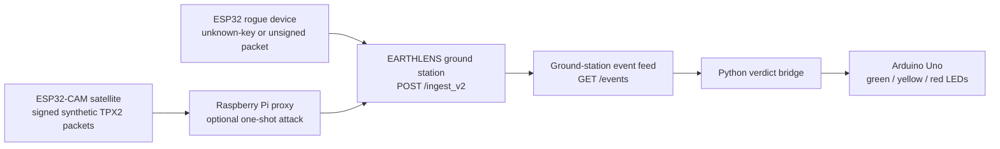

# EARTHLENS TPX2 Prototype

This repository contains a bench prototype for sending signed satellite-style packets to an EARTHLENS ground station, exercising packet-integrity scenarios, and showing the resulting trust verdict on LEDs.

## Prototype flow

The satellite sketch currently creates deterministic synthetic 4-band, 256 by 256 `uint16` pixel data. It does not yet read real imagery from an SD card. Each packet has a TPX2 header, an Ed25519 signature, and the pixel payload. The satellite advances its counter and chain link only after receiving a successful structured verdict response.

## Components

| Component | Location | Purpose |
|---|---|---|
| Trusted satellite | `tpx2-wifi-sat/firmware/tpx2_wifi_sat/` | ESP32-CAM packet sender for the trusted device key |
| Attack proxy | `earthlens-p41-proxy/attacker/` | Raspberry Pi HTTP proxy with one-shot tamper, stolen-key, replay, and drop modes |
| Rogue-device demo bundle | `earthlens-p42-demo-software/` | Rogue simulator and board sketches, verdict-light bridge, and focused tests |
| Verdict light | `earthlens-p42-demo-software/firmware/verdict_light/` | Arduino Uno display for the latest status |
| Bench notes | `earthlens-p42-demo-software/reports/DEMO_RUNBOOK.md` | Wiring and demonstration sequence |

The rogue device uses an intentionally untrusted demonstration key for the unknown-signer scenario. The unsigned scenario sends an all-zero signature field. These are test inputs for a ground station you control.

## Demonstration scenarios

| Scenario | Action | Expected result |
|---|---|---|
| D0 | Send an unchanged trusted packet | `TRUSTED` |
| D1 | Change pixels while retaining the original signature | `COMPROMISED` |
| D2 | Send a packet signed by an unknown key | `COMPROMISED` |
| D3 | Re-sign changed pixels with the satellite key through the proxy | `COMPROMISED`, followed by a chain-fork detection |
| D4 | Replay an authentic packet | `COMPROMISED` |
| D5 | Send a packet with no signature | `SUSPICIOUS` |
| D7 | Drop one packet, then resume forwarding | `SUSPICIOUS`, then `TRUSTED` after recovery |

The proxy attack is armed for one packet. The verdict light maps `TRUSTED` to green, `SUSPICIOUS` to yellow, and `COMPROMISED` to red.

## Bench setup

1. Start the EARTHLENS API with its device protocol, trusted-key configuration, and event endpoint available. The firmware posts to `/ingest_v2`; the light bridge reads `/events`.
2. Configure the Wi-Fi SSID, password, and ground-station host locally in the ESP32 sketches. The committed sketches contain placeholders; do not commit real network credentials.
3. Build the ESP32-CAM sketch with the Arduino ESP32 core, the Crypto library, and a locally supplied `device_seed.h` for the trusted device. Keep that header and all private keys out of Git.
4. Optionally start the attack proxy and arm a scenario using its terminal menu or `/__mode` endpoint. The proxy's stolen-key mode requires the satellite seed on the proxy host.
5. Connect the Uno LEDs through 220-ohm resistors to pins 8, 9, and 10, then run `scripts/verdict_light.py` from the demo software bundle. Without a serial port, it supports a console-only dry run.

Detailed commands and wiring notes are in [`DEMO_RUNBOOK.md`](earthlens-p42-demo-software/reports/DEMO_RUNBOOK.md).

## Repository layout and limits

The `earthlens-p42-demo-software` directory is a source bundle for the P42 prototype additions. Its simulator and tests depend on the EARTHLENS `tp` protocol modules and trusted ground-station behavior from the full application environment; this repository snapshot does not include that application runtime. The firmware sketches have not been compiled as part of this repository update.

Never commit `.env`, `*.pem`, `trusted_keys/`, `device_seed.h`, or other private key material. The Wi-Fi settings must be configured locally.